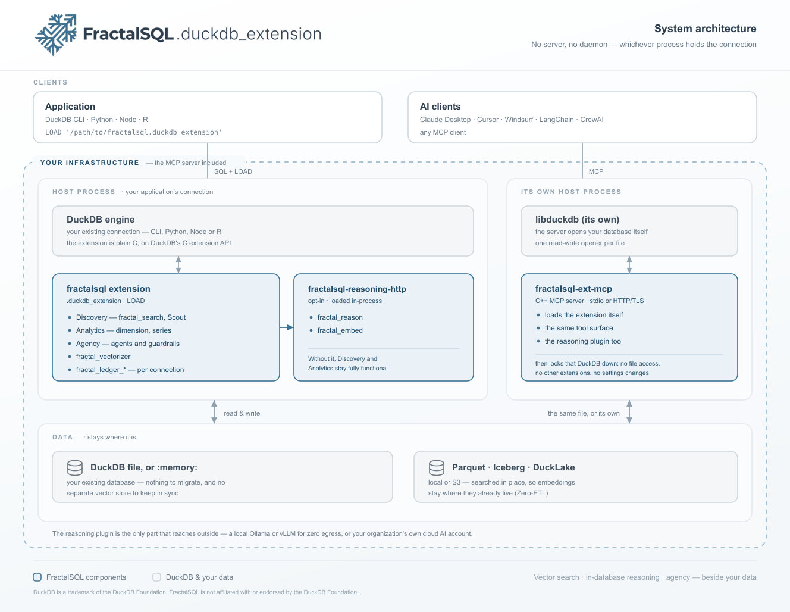

<p align="center">
  
</p>

# FractalSQL: Sovereign Data Intelligence
### AI Database Extension for DuckDB

**Vector Search. In-Database Reasoning. Production-Safe Agency. All beside your data.**

FractalSQL extends DuckDB into an active agentic database. FractalSQL adds what
traditional RAG (Retrieval-Augmented Generation) stops short of: reasoning
over what it retrieves, and when you enable it acting on the result, whether
that's running a generated query or executing a decision an agent computed, all
inside the same database process.

The retrieval side is genuinely DuckDB-shaped: vector search runs where the
data already lives, so embeddings sitting in Parquet / Iceberg / S3 stay put
(Zero-ETL into a separate vector DB):

```sql
SELECT id, fractal_search(embedding, $query::DOUBLE[]) AS dist
FROM read_parquet('s3://my-bucket/embeddings/*.parquet')
ORDER BY dist LIMIT 50;
```

The extension has no runtime dependencies beyond what DuckDB already needs.

By bringing reasoning and agency directly into the DuckDB backend, FractalSQL
enables **Sovereign Data Intelligence**: the ability to reason, plan, and act
upon your data with the deployment topology under your control. Run fully
on-prem or in your own containers with Ollama/vLLM for zero data egress, or
point at your organization's cloud AI accounts (Bedrock, Azure OpenAI, Vertex),
where your compliance posture requires it for managed-model scale. You control
the trade, not the product.

| Traditional RAG Stack | The Sovereign Way (FractalSQL) |
| --- | --- |
| **Mode Collapse**: top-K search returns near-duplicates, starving the LLM of diverse context. | **Scout Discovery**: MMR-style diverse semantic search that discovers the data's real structure. |
| **Fragmented Logic**: app pulls rows, calls LLM, handles retries, and glues answers in middleware. | **In-Database Reasoning**: reasoning and embedding happen inside the DuckDB host process itself. |
| **Passive Retrieval**: you ask a question, the DB returns rows, and you hope the LLM is correct. | **Autonomous Agency**: self-correcting SQL, loop detection, and trajectory forecasting. |

## From zero to your first agent

FractalSQL's docs follow a single linear path. Each step answers one question
and hands off to the next. You don't need to read everything; follow the path.

1. **What is this and why do I care?**: you are here. Sovereign Data
   Intelligence, in one page.
2. **How do I get the extension running in 60 seconds?** →
   [Getting Started](docs/getting-started.md) (`LOAD` the extension with
   `-unsigned`, then your first Scout search).
3. **How do I apply this to my industry?** → [Starter
   Kits](docs/starter-kits.md): runnable, industry-specific SQL scripts (SOC,
   FinTech, MedTech, Fleet, Smart-Cities, automotive, aerospace, telecom,
   climate tech, RF, …).
4. **How does a specific agent work and what are its inputs?** → [Agent
   Recipes](docs/api-agency.md): the built-in agents, each as a recipe.
5. **How do I build a proprietary agent that isn't in the box?** →
   [Composition Guide](docs/composition-guide.md): the design patterns behind
   the recipes.

> New here? Step 2 is a one-command demo. Step 3 drops you into a vertical
> that looks like your problem. Step 4 is the reference you'll keep coming
> back to.

## 🎯 Who are you?

Depending on your role, you'll want to start in different places:

- **AI Engineer**: You want to improve RAG quality and reasoning.
  → Start with [features](docs/features.md) and
  [reasoning-setup](docs/reasoning-setup.md).
- **DBA / Security Architect**: You care about stability, safety, and access
  control. → See the [Safety & Governance guide](docs/text-to-sql-setup.md#secure-it-authorization-vs-correctness).
- **Product Developer**: You want to build agentic features quickly.
  → Run the [Docker Demo](docs/docker-demo.md), then pick a
  [Starter Kit](docs/starter-kits.md).

## 🧩 What's in the box
<p align="center">
  
</p>
Four tiers of SQL-callable primitives, composable into agents with plain SQL
and application code, with no server-side language required.

- **Discovery**: diverse, mode-collapse-free retrieval: `fractal_search`
  (Sniper), `fractal_search_explore` (Scout).
- **Cognition**: in-process LLM integration: `fractal_reason` (Bedrock, Azure
  OpenAI, Vertex, Ollama), `fractal_embed`, `fractal_text_to_sql`.
- **Agency**: self-correcting routines: the search/sql agents,
  plan/trajectory/loop-detection helpers, see the [Agent
  Recipes](docs/api-agency.md). Sixteen recipe agents are registered (see
  [api-agency.md](docs/api-agency.md)).
- **Analytics**: fractal/dimension primitives: `fractal_dimension_dfa`,
  `fractal_dimension_boxcount`, `fractal_optimize_portfolio`, `fractal_cycle_detect`,
  `fractal_tda_persistence_diagram`, and more.

Plus DuckDB-native plumbing: vectors are plain `LIST(FLOAT)` /
`LIST(DOUBLE)` values (no separate vector type; the `fractal_vector_*`
math functions and their `fractal_vector_from/_to_float8_array` bridges work
on ordinary arrays), the background `fractal_vectorizer` embedding pipeline,
and the tamper-evident `fractal_ledger_*` audit surface. The full
function-surface reference with runnable examples lives in
[docs/features.md](docs/features.md), the per-function detail in
[api-discovery.md](docs/api-discovery.md), [api-cognition.md](docs/api-cognition.md),
[api-analytics.md](docs/api-analytics.md), and
[api-agency.md](docs/api-agency.md).

Reasoning is opt-in and provider-pluggable: the
[reasoning plugin](https://github.com/FractalSQLabs/fractalsql-reasoning-http)
speaks the OpenAI chat-completions wire format, so any OpenAI-compatible
endpoint works. Without a plugin configured, Discovery and Analytics are
fully functional and Cognition/Agency return clean precondition errors.

## SQL surface at a glance

```
fractal_edition() -> VARCHAR                     -- 'Community'
fractal_version() -> VARCHAR                     -- '2.0.1'
fractal_search(vector DOUBLE[], query DOUBLE[]) -> DOUBLE
fractal_search_debug(vector, k, max_iter, mdn) -> VARCHAR
fractal_search_explore(column, query[, options])           -- Scout aggregate
fractal_search_explore(table, column, query, opts)  -- Scout table function
fractal_reason(text[, prompt])                      -- via reasoning plugin
fractal_embed(text) -> LIST(DOUBLE)                 -- via reasoning plugin
fractal_text_to_sql(question[, tables]) -> VARCHAR
fractal_vectorizer_create(source_table[, ...])      -- embed pipeline
fractal_optimize_portfolio(...)                     -- cardinality-constrained
```

## 🚀 Get it running

The fastest path is one command:

```bash
{ echo "LOAD '$(pwd)/dist/amd64/fractalsql.v1.5.6.linux_amd64.duckdb_extension';"; \
  cat demo/demo.sql; } | duckdb -bail -unsigned
```

The file name includes the DuckDB version it targets. See the
[compatibility matrix](#compatibility-matrix) to pick yours, and
[Getting Started](docs/getting-started.md) for the full walkthrough.

### Install

1. **Download the artifact for your (DuckDB version, platform) cell** from
   [GitHub Releases](https://github.com/FractalSQLabs/fractalsql-ext/releases):
   - `fractalsql.v<DUCKDB_VER>.<PLATFORM>.duckdb_extension` -- raw extension
   - `fractalsql-ext-v<DUCKDB_VER>-<PLATFORM>.zip` -- bundle with
     `LICENSE`, `LICENSE-THIRD-PARTY`, `README.txt`
2. **Load from the DuckDB shell** (unsigned-opt-in required, see below):

```sql
LOAD '/path/to/fractalsql.v1.5.6.linux_amd64.duckdb_extension';
SELECT fractal_edition(), fractal_version();
-- returns: ('Community', '2.0.1')
```

3. **Or programmatic (Python / Node / R)**:

```python
import duckdb

con = duckdb.connect(config={"allow_unsigned_extensions": True})
con.load_extension('/path/to/fractalsql.v1.5.6.linux_amd64.duckdb_extension')
con.sql("SELECT fractal_edition(), fractal_version()").show()
```

```javascript
const duckdb = require('duckdb');
const db = new duckdb.Database(':memory:', { allow_unsigned_extensions: 'true' });
db.run("LOAD '/path/to/fractalsql.v1.5.6.linux_amd64.duckdb_extension'");
```

```r
library(duckdb)
con <- dbConnect(duckdb(), config = list(allow_unsigned_extensions = "true"))
dbExecute(con, "LOAD '/path/to/fractalsql.v1.5.6.linux_amd64.duckdb_extension'")
```

### Unsigned extension notice

The FractalSQL Community edition is unsigned, so DuckDB needs an opt-in: start
the CLI with `-unsigned`, or open the connection with
`allow_unsigned_extensions=true`. The examples above use one of these.

## 🏛️ FractalSQL Enterprise

Everything above is FractalSQL Community and fully functional on its own --
Discovery, Cognition, and Agency don't depend on anything in this section.
For regulated environments that need to **prove** what an agent decided
(tamper-evident, hash-chained decision records) and for the multimodal
portfolio functions `fractal_optimize_portfolio_multimodal` and
`fractal_optimize_portfolio_multimodal_pareto`, there's a FractalSQL
Enterprise tier: see
[FractalSQL Enterprise](docs/enterprise.md) for the full mechanism, including
what this build's in-memory, per-connection ledger can and can't prove.

## 📊 Compatibility & License

| DuckDB | Linux amd64 | Linux arm64 | Windows x64 | macOS |
| --- | :---: | :---: | :---: | :---: |
| 1.4 | ✓ | ✓ | ✓ | ✓ |
| 1.5 | ✓ | ✓ | ✓ | ✓ |
| 2.0 | ✓ | ✓ | ✓ | ✓ |

macOS builds cover Apple Silicon and Intel.

The latest patch release of each DuckDB line is supported. DuckDB 1.5 and
2.0 load the same stable-API build; DuckDB's 1.4 line has an unstable
extension API, so its build is tied to one 1.4.x release. The file name includes
the DuckDB version, and DuckDB refuses to load a 1.4 build on a different
version.

**License**: Apache-2.0. See `LICENSE`. Third-party components are under their
own permissive licenses (BSD-2-Clause, MIT, and others). See
`THIRD-PARTY-NOTICES.md`, which ships inside each release archive as
`LICENSE-THIRD-PARTY`.

DuckDB is a trademark of the DuckDB Foundation. FractalSQL is not affiliated
with or endorsed by the DuckDB Foundation.

For FractalSQL Enterprise licensing and support, contact
**enterprise@fractalsqlabs.com**.

## Building from source

The extension is plain C and calls DuckDB through its C extension API, so a
build takes seconds and needs no DuckDB source.

```bash
make                # native build -> dist/<platform>/ (Linux and macOS)

./build.sh amd64    # in Docker (glibc 2.34 baseline), one file per DuckDB version:
./build.sh arm64    #   dist/<arch>/fractalsql.v1.4.5.linux_<arch>.duckdb_extension
                    #   dist/<arch>/fractalsql.v1.5.6.linux_<arch>.duckdb_extension
                    #   dist/<arch>/fractalsql.v2.0.1.linux_<arch>.duckdb_extension
```

On Windows, run `scripts\windows\build.bat` from a Developer Command Prompt
for VS 2022 x64.

## 📚 Documentation

*Follow the path above; the links below are the same steps, expanded.*

- **[Getting Started](docs/getting-started.md)**: 60-second install and your
  first search.
- **[Starter Kits](docs/starter-kits.md)**: industry-specific runnable SQL
  scripts.
- **[Agent Recipes](docs/api-agency.md)**: the sixteen installable agents,
  each as a recipe.
- **[Composition Guide](docs/composition-guide.md)**: build your own agent.
- **[Features](docs/features.md)**: the full Capability Map and API reference.
- **[Reasoning Setup](docs/reasoning-setup.md)**: LLM provider configuration
  (Ollama, OpenAI, Bedrock, Azure, Vertex).
- **[Text-to-SQL Setup](docs/text-to-sql-setup.md)**: pipeline details and the
  security model.
- **[Vectorizer Setup](docs/vectorizer-setup.md)**: automatic embedding
  pipelines.
- **[MCP Plugin](docs/mcp-plugin.md)**: use FractalSQL from Claude Desktop, Cursor, Windsurf, LangChain, LlamaIndex, CrewAI, and many more MCP clients.
- **[Docker Demo](docs/docker-demo.md)**: from extension artifact to running
  a demo.
- **[Agent Blueprint Gallery](demo/README.md)**: the vertical demos, reference
  agents, and lakehouse demos for Iceberg and DuckLake.
- **[Benchmark](bench/README.md)**: HNSW vs Scout Mode, and Iceberg vs DuckLake
  commit and query cost.
- **[FractalSQL Enterprise](docs/enterprise.md)**: the tamper-evident decision
  ledger (CISO/audit).

