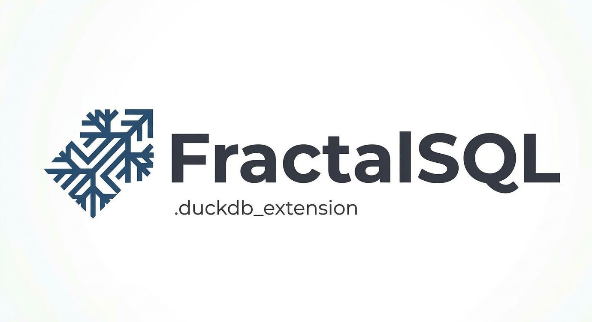

  

# FractalSQL for DuckDB -- packaging notes

FractalSQL for DuckDB is distributed as single-file DuckDB extensions.
There is **no** `.deb`, `.rpm`, `.apk` or `.msi` install shape
for DuckDB extensions: DuckDB loads extension files directly, per session,
with the CLI's `-unsigned` opt-in (this build is not published on DuckDB's
own extension repo). Nothing here registers files with the operating
system; `scripts/package.sh` is the only builder.

Artifacts are built and uploaded by a tag push (`v<X.Y.Z>`) through
`.github/workflows/release.yml`. The release carries **one bundle per
`(duckdb_version, platform)` cell**, plus `SHA256SUMS` and the two installers:

| Release asset | What it is |
| --- | --- |
| `fractalsql-ext-<duckdb_version>-<platform>.tar.gz` (`.zip` on Windows) | The bundle. It holds the extension, the optional reasoning plugin with its detached `.sig`, the MCP server with the DuckDB shared library it runs on, and the licence notices (see below). |
| `SHA256SUMS` | The SHA-256 of every asset above. `easy_install.sh` / `easy_install.ps1` verify the bundle they download against it. |
| `easy_install.sh`, `easy_install.ps1` | The installers, stamped with the release version. They download the bundle for your platform and DuckDB version, verify it, and place the extension (and, with `--with-reasoning`, the plugin) in DuckDB's extension directory. |

Inside a bundle (`fractalsql-ext-<duckdb_version>-<platform>/`):

| Path | What it is |
| --- | --- |
| `fractalsql.<duckdb_version>.<platform>.duckdb_extension` | The extension. Load it into your own DuckDB of that version. |
| `fractalsql-reasoning-http.so` / `.dll` and `.sig` | The optional reasoning plugin and its detached signature. The plugin loads only with its `.sig` beside it. |
| `mcp/` | The MCP server (`fractalsql-ext-mcp`), the DuckDB shared library of that version that it runs on (`libduckdb.so` / `.dylib` / `duckdb.dll`), its lock files and manifest. |
| `LICENSE`, `LICENSE-THIRD-PARTY` | This project's licence (Apache-2.0) and the third-party notices rendered for this cell. |
| `licenses/duckdb/` | DuckDB's `LICENSE` for that tag and the licence files of the third-party components in DuckDB's source tree, because the MCP server ships DuckDB's library. |
| `README.txt`, `load_extension.sql` | How to load the extension, and examples. |

The extension needs a DuckDB you already have (the CLI, Python, any client). The
DuckDB library under `mcp/` exists only for the MCP server; it is not a DuckDB
CLI.

`<platform>` is the DuckDB platform tag: `linux_amd64`, `linux_arm64`,
`osx_amd64`, `osx_arm64`, `windows_amd64`. The `<duckdb_version>` in the
file name is the DuckDB release the extension was built against (the
release covers `v1.4.5`, `v1.5.6` and `v2.0.0`). `v1.5.6` and `v2.0.0` are the same
stable-API build under two names; `v1.4.5` is a separate build for DuckDB's 1.4
line, which the DuckDB loader refuses on any other 1.4.x release. That is why
the version is part of the bundle name.

## Version table (v2.0.0)

| Component | Version |
| --- | --- |
| fractalsql-ext extension (Community) | 2.0.0 (`SELECT fractal_version();`) |
| Edition reported by `fractal_edition()` | `Community` |
| Vendored reasoning plugin (`fractalsql-reasoning-http`) | `reasoning-http v1.4.2` (see `include/REASONING_VERSION`) |
| FractalSQL core archive inside the extension | see `include/VERSION` |
| DuckDB versions shipped | v1.4.5, v1.5.6, v2.0.0 |

## Reasoning plugin

The optional Cognition tier plugin (`fractalsql-reasoning-http.so` /
`.dylib` / `.dll`) is vendored per-platform under `include/`. It is **not**
part of the extension: it ships as its own release assets (with its
detached signature), and also inside each release zip. The installers fetch
it from the release and place it in the install directory next to the
extension. It links
**libcurl** dynamically on the host on Linux and macOS (7.75.0+), so hosts
that run the reasoning tier there need libcurl installed through the
platform's normal package manager; the Windows build bundles libcurl
statically and needs no host copy. The extension itself has no runtime
dependency beyond libc. Configuration is environment variables only,
documented in [docs/reasoning-setup.md](../docs/reasoning-setup.md)
(`FRACTALSQL_REASONING_PLUGIN` plus the `FSQL_REASONING_HTTP_*` set).

Install with one command:

    # Linux / macOS
    curl -fsSL ... | sh      # see scripts/easy_install.sh --help
    # Windows (PowerShell)
    powershell -File scripts\windows\easy_install.ps1 -Help

both of which download the matching release artifact and place it under
`~/.duckdb/extensions/<version>/<platform>/` (DuckDB's own extension directory) so a `-unsigned` CLI can `LOAD 'fractalsql'` it by name.

DuckDB is a trademark of the DuckDB Foundation. FractalSQL is not affiliated
with or endorsed by the DuckDB Foundation.

## MCP server

The MCP server (`mcp/`, see `docs/mcp-plugin.md`) is released as its own archive per `(duckdb_version, platform)`:

| Artifact file | What it is |
| --- | --- |
| `fractalsql-ext-mcp-<duckdb_version>-linux_<arch>.tar.gz` (+ `.sha256`) | `fractalsql-ext-mcp`, the matching `libduckdb.so` beside it (found through `RPATH=$ORIGIN`), the manifest, the schema and safety locks, the README and the licences. Built by `scripts/package_mcp.sh`. Needs OpenSSL's runtime library. |
| `fractalsql-ext-mcp-<duckdb_version>-windows_amd64.zip` | `fractalsql-ext-mcp.exe` and `duckdb.dll`, built by `mcp\scripts\windows\build.bat`. |

Point `FSQL_DUCKDB_EXTENSION` at the extension file from the same release and DuckDB version (a locally built or released extension is
unsigned, so also set `FSQL_DUCKDB_ALLOW_UNSIGNED=true`).
